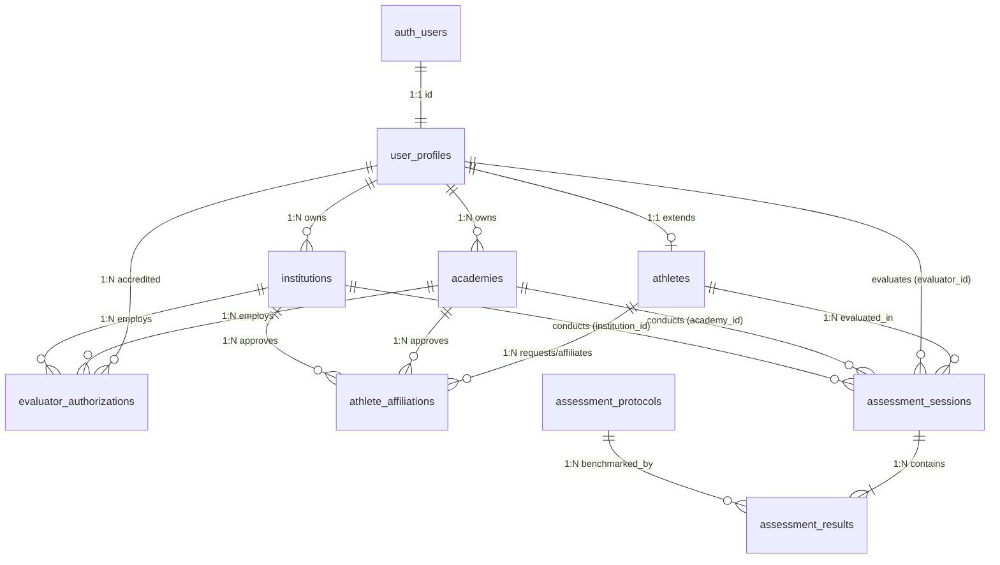

# PratibhaScan Web — Phase 2A Database Design Specification

**Company**: KAARYAN LABS  
**Product**: PratibhaScan (*AI-Powered Sports Talent Assessment & Development Platform*)  
**Phase**: Phase 2A — Secure Supabase Database Foundation  
**Date**: November 2026  
**Status**: Architecture Hardened & Tested Locally  

---

## 1. Core Architectural Objectives

The PratibhaScan database layer is engineered on **PostgreSQL / Supabase** to enforce:
1. **Three-Role Multi-Tenancy**: Dedicated models strictly for `athlete`, `academy`, and `institution`.
2. **Immutable Role Creation**: Users cannot self-assign or elevate privileges. Role assignment occurs strictly at signup and is locked by database triggers.
3. **Mutual Affiliation Governance**: Athletes and organizations must mutually establish active affiliations via `athlete_affiliations`. No academy or institution can access private biometric records merely by choosing a name.
4. **Assessment & Score Integrity**: Athletes are strictly prohibited from evaluating themselves (`check_no_self_evaluation`). Verified assessments are immutable (`guard_assessment_session_update`).
5. **Account Suspension Safeguards**: Suspended accounts (`is_suspended = TRUE`) are immediately denied all RLS read and write operations across the system.

---

## 2. Entity Relationship Diagram (ERD)

---

## 3. Database Tables & Schema Inventory

### 1. `public.user_profiles`
Extends `auth.users` with identity metadata, strictly enforced roles, and account state.
- `id` (UUID, PK, FK $\rightarrow$ `auth.users.id` ON DELETE CASCADE)
- `email` (TEXT, NOT NULL)
- `full_name` (TEXT, NOT NULL)
- `role` (TEXT, NOT NULL, CHECK $\in$ `('athlete', 'academy', 'institution')`)
- `phone_number` (TEXT)
- `avatar_url` (TEXT)
- `state` (TEXT)
- `district` (TEXT)
- `is_suspended` (BOOLEAN, DEFAULT FALSE, NOT NULL)
- `suspended_at` (TIMESTAMPTZ)
- `suspension_reason` (TEXT)
- `created_at` / `updated_at` (TIMESTAMPTZ)

### 2. `public.academies`
Sports academies, high-performance training centers, and club facilities.
- `id` (UUID, PK, DEFAULT `uuid_generate_v4()`)
- `owner_id` (UUID, FK $\rightarrow$ `auth.users.id` ON DELETE RESTRICT, NOT NULL)
- `name` (TEXT, NOT NULL)
- `registration_number` (TEXT, UNIQUE)
- `contact_email` (TEXT, NOT NULL)
- `contact_phone` (TEXT)
- `state` / `district` / `address` (TEXT)
- `sports_offered` (TEXT[], DEFAULT `'{}'`)
- `verified` (BOOLEAN, DEFAULT FALSE)
- `created_at` / `updated_at` (TIMESTAMPTZ)

### 3. `public.institutions`
State and district sports boards, schools, colleges, and athletic federations.
- `id` (UUID, PK, DEFAULT `uuid_generate_v4()`)
- `owner_id` (UUID, FK $\rightarrow$ `auth.users.id` ON DELETE RESTRICT, NOT NULL)
- `name` (TEXT, NOT NULL)
- `type` (TEXT, NOT NULL, CHECK $\in$ `('school', 'college', 'university', 'sports_board', 'federation')`)
- `contact_email` (TEXT, NOT NULL)
- `contact_phone` (TEXT)
- `state` / `district` (TEXT)
- `verified` (BOOLEAN, DEFAULT FALSE)
- `created_at` / `updated_at` (TIMESTAMPTZ)

### 4. `public.athletes`
Physical traits, foundational biometrics, and baseline sports orientation.
- `id` (UUID, PK, FK $\rightarrow$ `public.user_profiles.id` ON DELETE CASCADE)
- `date_of_birth` (DATE, NOT NULL)
- `gender` (TEXT, NOT NULL, CHECK $\in$ `('male', 'female', 'other')`)
- `primary_sport` (TEXT, NOT NULL)
- `secondary_sport` (TEXT)
- `height_cm` (NUMERIC(5,2), NOT NULL, CHECK $50 < \text{height} < 260$)
- `weight_kg` (NUMERIC(5,2), NOT NULL, CHECK $20 < \text{weight} < 300$)
- `wingspan_cm` (NUMERIC(5,2), CHECK $50 < \text{wingspan} < 280$)
- `composite_talent_score` (NUMERIC(5,2), DEFAULT 0, CHECK $0 \le \text{score} \le 100$)
- `created_at` / `updated_at` (TIMESTAMPTZ)

### 5. `public.athlete_affiliations`
Mutual consent and access management between athletes and organizations.
- `id` (UUID, PK, DEFAULT `uuid_generate_v4()`)
- `athlete_id` (UUID, FK $\rightarrow$ `public.athletes.id` ON DELETE CASCADE)
- `organization_type` (TEXT, CHECK $\in$ `('academy', 'institution')`)
- `academy_id` (UUID, FK $\rightarrow$ `public.academies.id` ON DELETE CASCADE)
- `institution_id` (UUID, FK $\rightarrow$ `public.institutions.id` ON DELETE CASCADE)
- `status` (TEXT, DEFAULT `'pending'`, CHECK $\in$ `('pending', 'active', 'rejected', 'revoked')`)
- `requested_by` (UUID, FK $\rightarrow$ `auth.users.id`)
- `approved_by` (UUID, FK $\rightarrow$ `auth.users.id`)
- `created_at` / `updated_at` (TIMESTAMPTZ)

### 6. `public.evaluator_authorizations`
Registry of certified testing officials and coaches authorized to conduct assessments.
- `id` (UUID, PK, DEFAULT `uuid_generate_v4()`)
- `evaluator_id` (UUID, FK $\rightarrow$ `public.user_profiles.id` ON DELETE CASCADE)
- `organization_type` (TEXT, CHECK $\in$ `('academy', 'institution')`)
- `academy_id` (UUID, FK $\rightarrow$ `public.academies.id` ON DELETE CASCADE)
- `institution_id` (UUID, FK $\rightarrow$ `public.institutions.id` ON DELETE CASCADE)
- `accreditation_number` (TEXT)
- `status` (TEXT, DEFAULT `'active'`, CHECK $\in$ `('active', 'suspended', 'revoked')`)
- `created_at` (TIMESTAMPTZ)

### 7. `public.assessment_protocols`
Immutable benchmark test definitions modeled on Sports Authority of India procedures.
- `id` (UUID, PK, DEFAULT `uuid_generate_v4()`)
- `code` (TEXT, UNIQUE, NOT NULL)
- `title` (TEXT, NOT NULL)
- `category` (TEXT, CHECK $\in$ `('anthropometric', 'speed', 'endurance', 'power', 'agility', 'flexibility')`)
- `unit` (TEXT, NOT NULL)
- `lower_is_better` (BOOLEAN, DEFAULT FALSE)
- `description` / `methodology` (TEXT)
- `equipment_required` (TEXT[])

### 8. `public.assessment_sessions`
Scheduled field testing sessions with mandatory anti-tampering guards.
- `id` (UUID, PK, DEFAULT `uuid_generate_v4()`)
- `athlete_id` (UUID, FK $\rightarrow$ `public.athletes.id` ON DELETE CASCADE, NOT NULL)
- `evaluator_id` (UUID, FK $\rightarrow$ `public.user_profiles.id`, NOT NULL)
- `academy_id` (UUID, FK $\rightarrow$ `public.academies.id` ON DELETE SET NULL)
- `institution_id` (UUID, FK $\rightarrow$ `public.institutions.id` ON DELETE SET NULL)
- `assessment_date` (DATE, NOT NULL)
- `venue` (TEXT)
- `verified` (BOOLEAN, DEFAULT FALSE, NOT NULL)
- `verified_by` (UUID, FK $\rightarrow$ `auth.users.id`)
- `notes` (TEXT)
- `created_at` (TIMESTAMPTZ)
- *Constraint*: `CONSTRAINT check_no_self_evaluation CHECK (athlete_id != evaluator_id)`

### 9. `public.assessment_results`
Multi-trial physical test data recorded during an assessment session.
- `id` (UUID, PK, DEFAULT `uuid_generate_v4()`)
- `session_id` (UUID, FK $\rightarrow$ `public.assessment_sessions.id` ON DELETE CASCADE, NOT NULL)
- `protocol_id` (UUID, FK $\rightarrow$ `public.assessment_protocols.id`, NOT NULL)
- `trial_1`, `trial_2`, `trial_3` (NUMERIC(8,2), CHECK $\ge 0$)
- `best_score` (NUMERIC(8,2), NOT NULL, CHECK $\ge 0$)
- `percentile_rank` (NUMERIC(5,2), CHECK $0 \le \text{rank} \le 100$)
- `status` (TEXT, DEFAULT `'pending'`, CHECK $\in$ `('pending', 'verified', 'flagged')`)
- `created_at` (TIMESTAMPTZ)

---

## 4. Role Permissions Matrix

| Entity | Athlete | Academy Owner | Institution Officer | Anonymous |
| :--- | :--- | :--- | :--- | :--- |
| **`user_profiles`** | Read active; Update own (non-role fields) | Read active; Update own | Read active; Update own | Denied |
| **`academies`** | Read public/verified | Create, Read, Update, Delete own | Read public/verified | Denied |
| **`institutions`**| Read public/verified | Read public/verified | Create, Read, Update, Delete own | Denied |
| **`athletes`** | Read active; Update own biometrics | Read affiliated athletes | Read affiliated athletes / scouting pool | Denied |
| **`affiliations`** | Request or respond to invitations | Request or approve athlete roster | Request or approve athlete roster | Denied |
| **`protocols`** | Read-only | Read-only | Read-only | Denied |
| **`sessions`** | Read own sessions; Cannot evaluate self | Create, update unverified; Verify | Create, update unverified; Verify | Denied |
| **`results`** | Read own results; Cannot edit | Insert/Update unverified evaluations | Insert/Update unverified evaluations | Denied |
| **`passports`** | Read own passport | Read affiliated athlete passports | Read affiliated athlete passports | Denied |
