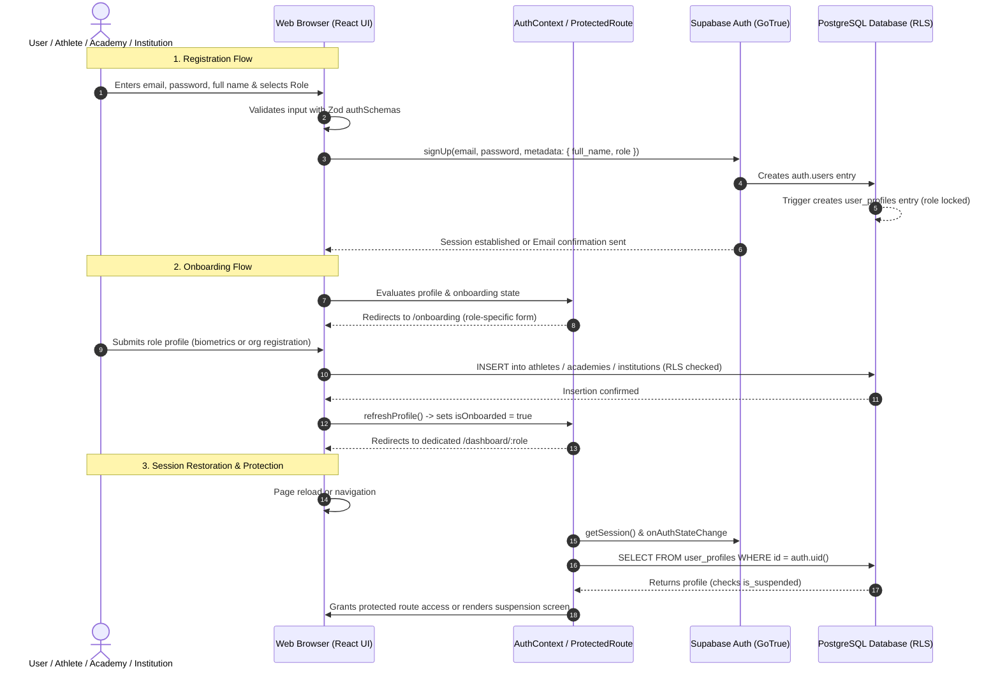

# PratibhaScan Web — Phase 2B Authentication & Onboarding Architecture Specification

**Company**: KAARYAN LABS  
**Product**: PratibhaScan (*AI-Powered Sports Talent Assessment & Development Platform*)  
**Phase**: Phase 2B — Premium Authentication & Secure User Onboarding  
**Date**: November 2026  
**Status**: Implemented, Verified & Fully Integrated Locally  

---

## 1. Architectural Overview

Phase 2B implements a production-grade, secure, and accessible authentication and onboarding subsystem for the PratibhaScan web application. The implementation combines **Supabase Auth (GoTrue)**, a strongly typed React state management layer ([`AuthContext.tsx`](file:///c:/Users/kthar/OneDrive/Documents/Web-PratibhaScan/src/features/auth/AuthContext.tsx)), Zod schema-driven input validation ([`authSchemas.ts`](file:///c:/Users/kthar/OneDrive/Documents/Web-PratibhaScan/src/features/auth/authSchemas.ts)), and deep database-level multi-tenancy enforcement.

The user experience strictly adheres to the PratibhaScan design system: a premium light-themed UI utilizing deep navy typography (`#0A192F`), vibrant teal primary accents (`#0D9488`), clean card surfaces, and accessible focus states.

### Architectural Diagram



---

## 2. Core Authentication State Machine

The authentication state is managed centrally within [`src/features/auth/AuthContext.tsx`](file:///c:/Users/kthar/OneDrive/Documents/Web-PratibhaScan/src/features/auth/AuthContext.tsx), exposing the `useAuth()` hook.

### State Model

| Property | Type | Description |
| :--- | :--- | :--- |
| `user` | `User \| null` | Authenticated Supabase user object containing UUID, email, and identity tokens. |
| `session` | `Session \| null` | Active JWT access token, refresh token, and expiration timestamp. |
| `profile` | `UserProfile \| null` | Profile record synchronized with `public.user_profiles` table. |
| `isLoading` | `boolean` | `true` while the session or database profile is being fetched. |
| `isSuspended` | `boolean` | `true` if `profile.is_suspended === true`, immediately locking out all platform actions. |
| `isOnboarded` | `boolean` | Computed dynamically from relational records (`athletes`, `academies`, `institutions`). |

### Session Lifecycle Methods

1. **`signIn(email, password)`**:
   - Calls `supabase.auth.signInWithPassword({ email, password })`.
   - Fetches the active `user_profiles` row to load role, name, and suspension status.
   - Evaluates whether the user has completed onboarding for their role.
   - Throws user-friendly errors (`"Invalid email or password"`, `"Email not confirmed"`, `"Account suspended"`).

2. **`signUp(email, password, fullName, role)`**:
   - Calls `supabase.auth.signUp({ email, password, options: { data: { full_name, role } } })`.
   - Passes role metadata to initialize the database user profile trigger.
   - Returns session or email confirmation notice.

3. **`signOut()`**:
   - Clears the Supabase session token via `supabase.auth.signOut()`.
   - Resets user, profile, and onboarding states in React memory.
   - Redirects to `/login`.

4. **`resetPassword(email)`**:
   - Initiates a password reset email via `supabase.auth.resetPasswordForEmail(email, { redirectTo })`.
   - Redirects the user to `/auth/callback?type=recovery` upon link invocation.

5. **`updatePassword(newPassword)`**:
   - Authenticates new credentials via `supabase.auth.updateUser({ password })`.
   - Completed upon password recovery token exchange.

6. **`refreshProfile()`**:
   - Re-queries `public.user_profiles` and role tables on-demand to guarantee immediate consistency after onboarding or updates.

---

## 3. Strict Three-Role Onboarding Architecture

PratibhaScan enforces exactly three primary application roles:
- **`athlete`**: Individual sports candidates, grassroot talents, and student-athletes.
- **`academy`**: Private sports academies, specialized training centers, and sports clubs.
- **`institution`**: Schools, universities, sports federations, and state sports boards.

### Role Onboarding Specifications

```
                     ┌──────────────────────────────┐
                     │     Registration Complete    │
                     │  (Role chosen at /register)  │
                     └──────────────┬───────────────┘
                                    │
                                    ▼
                     ┌──────────────────────────────┐
                     │   Check Onboarding Status    │
                     │     GET /onboarding          │
                     └──────┬───────┬────────┬──────┘
                            │       │        │
               role=athlete │       │        │ role=institution
                            │       │        │
                            │       │ role=academy
                            ▼       ▼        ▼
┌─────────────────────────────┐ ┌───────────────────────────┐ ┌─────────────────────────────┐
│   Athlete Biometrics Form   │ │ Academy Registration Form │ │ Institution Enrollment Form │
├─────────────────────────────┤ ├───────────────────────────┤ ├─────────────────────────────┤
│ • Date of Birth             │ │ • Academy / Club Name     │ │ • Institution Name          │
│ • Gender                    │ │ • Registration / Reg No   │ │ • Category (School/College) │
│ • Primary & Secondary Sport │ │ • Official Contact Email  │ │ • Affiliated Board / Univ   │
│ • Height (cm) & Weight (kg) │ │ • Phone Number            │ │ • Principal / Director Name │
│ • Dominant Hand & Foot      │ │ • State & District        │ │ • Official Email & Phone    │
│ • State & District          │ │ • Sports Programs Offered │ │ • State & District          │
└──────────────┬──────────────┘ └─────────────┬─────────────┘ └──────────────┬──────────────┘
               │                              │                              │
               ▼                              ▼                              ▼
┌─────────────────────────────┐ ┌───────────────────────────┐ ┌─────────────────────────────┐
│ INSERT INTO public.athletes │ │ INSERT INTO academies     │ │ INSERT INTO institutions    │
└──────────────┬──────────────┘ └─────────────┬─────────────┘ └──────────────┬──────────────┘
               │                              │                              │
               └──────────────────────┬──────────────────────────────────────┘
                                      │
                                      ▼
                      ┌────────────────────────────────┐
                      │ refreshProfile()               │
                      │ Redirect to /dashboard/:role   │
                      └────────────────────────────────┘
```

### Dynamic Onboarding Evaluation Strategy
Rather than relying on a mutable client boolean or a redundant `is_onboarded` flag in `user_profiles`, PratibhaScan evaluates onboarding status through relational integrity:
- **Athlete**: `SELECT id FROM public.athletes WHERE user_id = auth.uid()`
- **Academy**: `SELECT id FROM public.academies WHERE owner_id = auth.uid()`
- **Institution**: `SELECT id FROM public.institutions WHERE owner_id = auth.uid()`

This prevents race conditions and guarantees that users cannot bypass mandatory onboarding without genuine records existing in the corresponding database table.

---

## 4. Protected Routing and Tenant Isolation

Routing protection is implemented via [`src/features/auth/ProtectedRoute.tsx`](file:///c:/Users/kthar/OneDrive/Documents/Web-PratibhaScan/src/features/auth/ProtectedRoute.tsx).

### Route Protection Hierarchy

1. **Authentication Check**: If `user == null`, redirect immediately to `/login` preserving `location.pathname` in `state.from`.
2. **Account Suspension Check**: If `profile.is_suspended === true`, render the dedicated, non-dismissible Account Suspended Security View.
3. **Onboarding Enforcement**: If `!isOnboarded` and the current path is not `/onboarding`, redirect to `/onboarding`.
4. **Role Isolation Check**: If `allowedRoles` is specified and does not contain `profile.role`, redirect to the user's authorized role dashboard (`/dashboard/${profile.role}`).
5. **Dashboard Shell Isolation**:
   - In authenticated mode, the UI role switcher is completely hidden. The dashboard is hard-locked to the authenticated user's role.
   - An "Authenticated Portal" banner confirms active role identity and user full name.
   - A dedicated `/preview` route is preserved exclusively for unauthenticated design review and evaluation.

---

## 5. Security & Input Validation Guarantees

All user inputs are validated before dispatch using **Zod** in [`src/features/auth/authSchemas.ts`](file:///c:/Users/kthar/OneDrive/Documents/Web-PratibhaScan/src/features/auth/authSchemas.ts):

| Form / Schema | Validation Rules & Constraints |
| :--- | :--- |
| **Login (`loginSchema`)** | Valid email RFC format; password minimum 6 characters. |
| **Registration (`registerSchema`)** | Valid email; password $\ge$ 8 characters with at least one letter and one number; password confirmation match; full name $\ge$ 2 characters; role strictly `athlete`, `academy`, or `institution`; acceptance of terms. |
| **Forgot Password (`forgotPasswordSchema`)** | Valid email format. |
| **Reset Password (`resetPasswordSchema`)** | Password $\ge$ 8 characters with alphanumeric requirements; exact confirmation match. |
| **Athlete Onboarding (`athleteOnboardingSchema`)** | Valid DOB; gender selection; primary sport; height (50–250 cm); weight (20–200 kg); state and district required. |
| **Academy Onboarding (`academyOnboardingSchema`)** | Academy name $\ge$ 3 chars; contact email; phone $\ge$ 10 digits; state, district, and address; at least 1 sport selected. |
| **Institution Onboarding (`institutionOnboardingSchema`)** | Institution name $\ge$ 3 chars; institution category; contact email and phone; state and district required. |

### Defense-in-Depth Security Matrix

1. **Client-Side Layer**: Strict Zod schema validation; form submission debouncing; sanitization; typed models.
2. **Transport Layer**: Secure HTTPS; JWT bearer tokens; local storage session persistence with automatic token refresh.
3. **PostgreSQL RLS Layer**: All tables enforce Row-Level Security (`ALTER TABLE ... ENABLE ROW LEVEL SECURITY`). Authenticated users can only read and write rows owned by their `auth.uid()`.
4. **Database Constraint Layer**:
   - Foreign key constraints prevent orphaned records.
   - `check_no_self_evaluation` prevents athletes from generating their own assessment ratings.
   - Trigger `lock_user_profile_role` prohibits post-registration role updates.

---

## 6. Implementation Files Inventory

- [`src/features/auth/authSchemas.ts`](file:///c:/Users/kthar/OneDrive/Documents/Web-PratibhaScan/src/features/auth/authSchemas.ts): Zod validation schemas for all authentication and onboarding operations.
- [`src/features/auth/AuthContext.tsx`](file:///c:/Users/kthar/OneDrive/Documents/Web-PratibhaScan/src/features/auth/AuthContext.tsx): Centralized authentication provider, session observer, and role synchronization.
- [`src/features/auth/ProtectedRoute.tsx`](file:///c:/Users/kthar/OneDrive/Documents/Web-PratibhaScan/src/features/auth/ProtectedRoute.tsx): Route security wrapper with multi-tier authorization checks.
- [`src/features/auth/LoginPage.tsx`](file:///c:/Users/kthar/OneDrive/Documents/Web-PratibhaScan/src/features/auth/LoginPage.tsx): Accessible, responsive sign-in interface.
- [`src/features/auth/RegisterPage.tsx`](file:///c:/Users/kthar/OneDrive/Documents/Web-PratibhaScan/src/features/auth/RegisterPage.tsx): Three-role registration with email verification feedback.
- [`src/features/auth/ForgotPasswordPage.tsx`](file:///c:/Users/kthar/OneDrive/Documents/Web-PratibhaScan/src/features/auth/ForgotPasswordPage.tsx): Password recovery request interface.
- [`src/features/auth/ResetPasswordPage.tsx`](file:///c:/Users/kthar/OneDrive/Documents/Web-PratibhaScan/src/features/auth/ResetPasswordPage.tsx): New password setting view with confirmation validation.
- [`src/features/auth/AuthCallbackPage.tsx`](file:///c:/Users/kthar/OneDrive/Documents/Web-PratibhaScan/src/features/auth/AuthCallbackPage.tsx): OAuth/Email callback handler with exchange resilience.
- [`src/features/onboarding/OnboardingPage.tsx`](file:///c:/Users/kthar/OneDrive/Documents/Web-PratibhaScan/src/features/onboarding/OnboardingPage.tsx): Comprehensive 3-role onboarding wizard.
- [`src/routes/AppRoutes.tsx`](file:///c:/Users/kthar/OneDrive/Documents/Web-PratibhaScan/src/routes/AppRoutes.tsx): Route definitions with role-protected dashboards and preview separation.
- [`src/components/layout/DashboardShell.tsx`](file:///c:/Users/kthar/OneDrive/Documents/Web-PratibhaScan/src/components/layout/DashboardShell.tsx): Layout enforcing role locking for authenticated sessions.
- [`src/components/layout/DashboardTopNav.tsx`](file:///c:/Users/kthar/OneDrive/Documents/Web-PratibhaScan/src/components/layout/DashboardTopNav.tsx): Top navigation with user identity chip and sign-out controls.
- [`src/components/layout/PublicHeader.tsx`](file:///c:/Users/kthar/OneDrive/Documents/Web-PratibhaScan/src/components/layout/PublicHeader.tsx): Context-aware navigation bar reflecting live session state.
- [`src/types/database.types.ts`](file:///c:/Users/kthar/OneDrive/Documents/Web-PratibhaScan/src/types/database.types.ts): Strongly typed schema interfaces compatible with Supabase JS v2.
