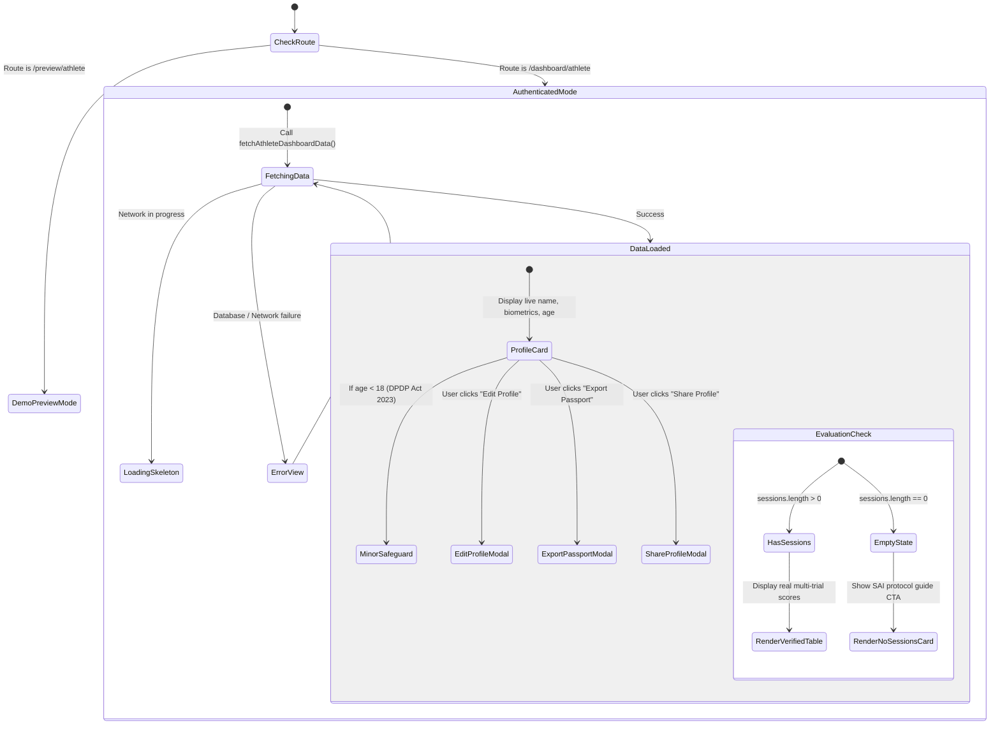

# PratibhaScan Web — Phase 3A Athlete Dashboard Specification

**Company**: KAARYAN LABS  
**Product**: PratibhaScan (*AI-Powered Sports Talent Assessment & Development Platform*)  
**Phase**: Phase 3A — Real Athlete Dashboard & Supabase Data Integration  
**Date**: November 2026  
**Status**: Implemented, Verified & Connected to Local Supabase  

---

## 1. Architectural Overview & Value Mapping

Phase 3A elevates the Athlete Dashboard from a static visual mockup into a live, database-backed operational portal. The dashboard is powered by **Supabase PostgreSQL**, guarded by **Row-Level Security (RLS)**, and managed via typed services in [`src/features/athlete/athleteService.ts`](file:///c:/Users/kthar/OneDrive/Documents/Web-PratibhaScan/src/features/athlete/athleteService.ts).

### Complete Mapping of Dashboard Display Values

| Visual Component | Display Label | Data Classification | Database Source / Derivation |
| :--- | :--- | :--- | :--- |
| **Header Badge** | "Live Connected" | System State | Authenticated session (`useAuth().user`) |
| **Athlete Name** | Full Name | **Real & Connected** | `public.user_profiles.full_name` |
| **Athlete ID** | `ATH-XXXXXXXX` | **Calculated** | Derived from `public.athletes.id` (`ATH-${id.slice(0,8).toUpperCase()}`) |
| **Sport & Event** | Primary & Secondary Sport | **Real & Connected** | `public.athletes.primary_sport`, `public.athletes.secondary_sport` |
| **Location** | District, State | **Real & Connected** | `public.user_profiles.district`, `public.user_profiles.state` |
| **Chronological Age**| Age in years | **Calculated** | Computed dynamically from `public.athletes.date_of_birth` |
| **Date of Birth** | DOB (YYYY-MM-DD) | **Real & Connected** | `public.athletes.date_of_birth` |
| **Minor Status** | DPDP Act 2023 Safeguards | **Calculated** | `age < 18` triggers [`MinorSafeguardBanner.tsx`](file:///c:/Users/kthar/OneDrive/Documents/Web-PratibhaScan/src/features/athlete/MinorSafeguardBanner.tsx) |
| **Standing Height**| Height (cm) | **Real & Connected** | `public.athletes.height_cm` |
| **Body Mass** | Weight (kg) & BMI | **Real & Calculated** | `public.athletes.weight_kg`, BMI computed as $\frac{\text{weight}}{\text{height}^2}$ |
| **Wingspan** | Wingspan & Ape Index | **Real & Calculated** | `public.athletes.wingspan_cm`, Ape Index computed as $\text{wingspan} - \text{height}$ |
| **Affiliation** | Academy / Institution Name | **Real & Connected** | `public.athlete_affiliations` join `academies` / `institutions` where `status = 'active'` |
| **30m Acceleration**| Best Mark (sec) & Percentile | **Real & Connected** | `assessment_results.best_score` for `TEST_30M_SPRINT` (or Pending if no session) |
| **Vertical Jump** | Best Mark (cm) & Percentile | **Real & Connected** | `assessment_results.best_score` for `TEST_VERT_JUMP` (or Pending if no session) |
| **Yo-Yo / Beep Test**| Level & Percentile | **Real & Connected** | `assessment_results.best_score` for `TEST_BEEP_RUN` (or Pending if no session) |
| **Protocol Log** | Standardized SAI Test Table | **Real & Connected** | `assessment_sessions` + `assessment_results` + `assessment_protocols` |
| **Session Evaluator**| Evaluator Name | **Real & Connected** | `public.user_profiles.full_name` via `assessment_sessions.evaluator_id` |
| **Verification State**| "Officially Verified" | **Real & Connected** | `public.assessment_sessions.verified = TRUE` |
| **Longitudinal Trends**| Performance Progress | **Real & Connected** | Ordered multi-session progression or automated educational placeholder |

---

## 2. Athlete Profile Mutation & Permitted Fields

To maintain database security, strict boundaries are enforced between user-editable fields and protected system fields.

### Permitted Profile Update Fields
Managed via [`AthleteEditModal.tsx`](file:///c:/Users/kthar/OneDrive/Documents/Web-PratibhaScan/src/features/athlete/AthleteEditModal.tsx) and validated by [`athleteSchemas.ts`](file:///c:/Users/kthar/OneDrive/Documents/Web-PratibhaScan/src/features/athlete/athleteSchemas.ts):
- **Full Name**: Minimum 2 characters, maximum 100 characters (`user_profiles.full_name`)
- **Phone Number**: Optional valid 10–15 digit format (`user_profiles.phone_number`)
- **State & District**: Geopolitical location (`user_profiles.state`, `user_profiles.district`)
- **Primary & Secondary Sport**: Candidate sports profile (`athletes.primary_sport`, `athletes.secondary_sport`)
- **Biometric Dimensions**:
  - Standing Height: 50.0 cm to 260.0 cm (`athletes.height_cm`)
  - Body Mass: 20.0 kg to 300.0 kg (`athletes.weight_kg`)
  - Wingspan: 50.0 cm to 280.0 cm (`athletes.wingspan_cm`)

### Strictly Protected Fields (Immutable by Athlete)
1. **User Role (`role`)**: Locked to `'athlete'`. Prevented at the database level by the `guard_user_profile_update` trigger (`SQLSTATE P0001`).
2. **Account Suspension (`is_suspended`)**: Modifying suspension status raises `"Users cannot modify their own suspension status"`.
3. **Assessment Results & Scores**: Athletes cannot insert or edit assessment scores (`check_no_self_evaluation` constraint + evaluator RLS policies).
4. **Ownership & Permissions**: Athletes cannot self-assign academy ownership or create evaluator credentials.

---

## 3. Real Dashboard Experience: States & Handling

The dashboard implements dedicated visual states to eliminate synthetic mock data from the authenticated portal:

1. **Loading State**: High-fidelity animated skeletons and loading indicator while relational queries resolve.
2. **Error State**: Informative alert card with error details and a direct "Retry Connection" action.
3. **Empty States**:
   - **No Affiliation**: Displays `"Independent / Unaffiliated"` badge with guidance on joining an academy.
   - **No Assessment Sessions**: Displays an elegant `"No Assessment Sessions Recorded Yet"` card explaining standard SAI protocols and linking to `/dashboard/assessments`.
   - **Awaiting Key Benchmarks**: Instead of inventing scores (e.g. 3.88s sprint), cards display `"Pending Assessment"` with standard benchmark reference targets.
4. **Separation from Demo Mode**: The unauthenticated preview at [`/preview/athlete`](file:///c:/Users/kthar/OneDrive/Documents/Web-PratibhaScan/src/routes/AppRoutes.tsx) is explicitly segregated using `isPreview={true}`, displaying prominent demonstration banners.

---

## 4. Privacy & Minor Safeguards (DPDP Act 2023)

PratibhaScan implements strict minor-athlete protections in compliance with the **Digital Personal Data Protection Act, 2023 (Section 9 - Processing of Personal Data of Children)**:

1. **Minor Athlete Detection**:
   - Evaluated dynamically in [`athleteService.ts`](file:///c:/Users/kthar/OneDrive/Documents/Web-PratibhaScan/src/features/athlete/athleteService.ts) via `calculateAge(dob) < 18`.
2. **Safeguard Banner**:
   - Minor athlete dashboards render [`MinorSafeguardBanner.tsx`](file:///c:/Users/kthar/OneDrive/Documents/Web-PratibhaScan/src/features/athlete/MinorSafeguardBanner.tsx) informing the candidate and guardians of restricted data access rules.
3. **Access Isolation**:
   - Biometric dimensions and assessment trials are shielded from anonymous and unaffiliated users via PostgreSQL Row-Level Security (`has_active_academy_affiliation` and `has_active_institution_affiliation`).
4. **Development Constraint**:
   - In development and local testing, only synthetic accounts (`@test.kaaryanlabs.local`) are utilized. Real minor-athlete data collection is blocked until Phase 3B institutional guardian consent flows are fully audited.

---

## 5. Security & Authorization Guarantees

1. **Self-Access Only**: An athlete can read and edit only records matching `auth.uid() = id`.
2. **Cross-Tenant Isolation**: Queries by Athlete B for Athlete A's private assessment sessions return exactly 0 rows.
3. **Write Protection**: Athlete B attempting to update Athlete A's height or name is rejected by PostgreSQL RLS.
4. **Suspended Accounts**: When `is_suspended = true`, database reads return 0 rows and writes are denied by `public.is_active_user(auth.uid())`.
5. **Anonymous Access Denied**: Anonymous requests to `assessment_sessions` return 0 rows.

---

## 6. Implementation Files Inventory

- [`src/features/athlete/athleteService.ts`](file:///c:/Users/kthar/OneDrive/Documents/Web-PratibhaScan/src/features/athlete/athleteService.ts): Relational query fetcher, age calculation, Ape Index, BMI, and profile mutation handler.
- [`src/features/athlete/athleteSchemas.ts`](file:///c:/Users/kthar/OneDrive/Documents/Web-PratibhaScan/src/features/athlete/athleteSchemas.ts): Zod schema for athlete profile updates with boundary checks.
- [`src/features/athlete/AthleteView.tsx`](file:///c:/Users/kthar/OneDrive/Documents/Web-PratibhaScan/src/features/athlete/AthleteView.tsx): Main dashboard view supporting live Supabase mode and preview mode.
- [`src/features/athlete/AthleteEditModal.tsx`](file:///c:/Users/kthar/OneDrive/Documents/Web-PratibhaScan/src/features/athlete/AthleteEditModal.tsx): Interactive profile editor modal with real-time feedback.
- [`src/features/athlete/AthletePassportExportModal.tsx`](file:///c:/Users/kthar/OneDrive/Documents/Web-PratibhaScan/src/features/athlete/AthletePassportExportModal.tsx): Printable verified sports passport summary.
- [`src/features/athlete/MinorSafeguardBanner.tsx`](file:///c:/Users/kthar/OneDrive/Documents/Web-PratibhaScan/src/features/athlete/MinorSafeguardBanner.tsx): DPDP Act 2023 minor athlete privacy alert.
- [`src/routes/AppRoutes.tsx`](file:///c:/Users/kthar/OneDrive/Documents/Web-PratibhaScan/src/routes/AppRoutes.tsx): Route configuration cleanly passing `isPreview={true}` to demo routes.
- [`src/features/athlete/__tests__/athleteData.test.ts`](file:///c:/Users/kthar/OneDrive/Documents/Web-PratibhaScan/src/features/athlete/__tests__/athleteData.test.ts): Unit tests for calculations, schemas, and mutation sanitization.
- [`tests/integration/phase3a_athlete_dashboard.mjs`](file:///c:/Users/kthar/OneDrive/Documents/Web-PratibhaScan/tests/integration/phase3a_athlete_dashboard.mjs): 15 live integration tests against local Supabase GoTrue & PostgreSQL.
