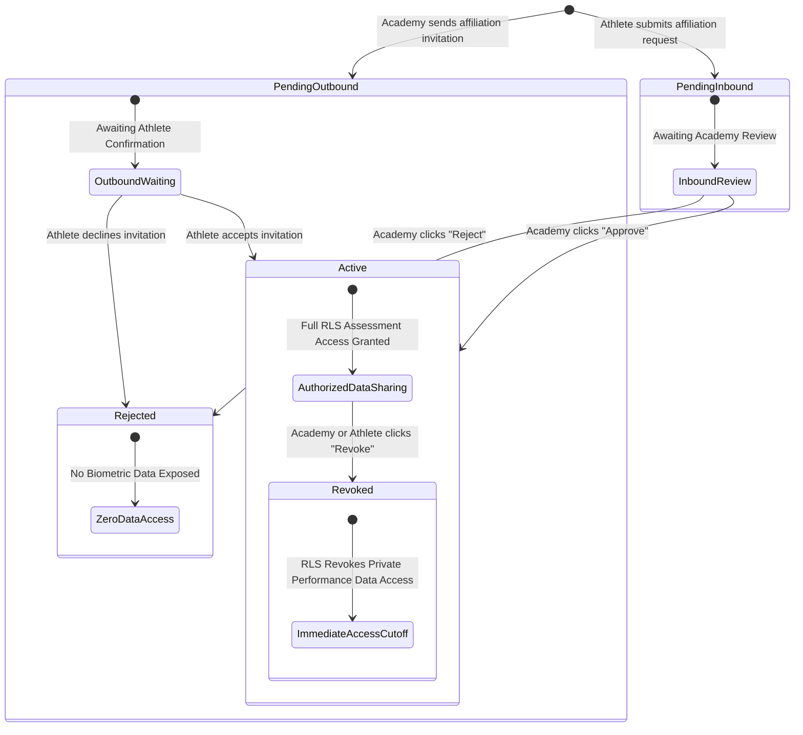

# PratibhaScan Web — Phase 3B Academy Hub Specification

**Company**: KAARYAN LABS  
**Product**: PratibhaScan (*AI-Powered Sports Talent Assessment & Development Platform*)  
**Phase**: Phase 3B — Academy Hub & Secure Athlete Management  
**Date**: November 2026  
**Status**: Implemented, Verified & Connected to Local Supabase  

---

## 1. Architectural Overview & Value Mapping

Phase 3B converts the Academy dashboard from an illustrative static interface into a production-ready, secure **Academy Hub**. The hub enables registered sports academies and high-performance training centers to manage their candidate rosters, execute authorization-safe athlete affiliations, track pending applications, and access standardized assessment sessions without leaking cross-academy data.

All interactions are backed by **Supabase PostgreSQL**, protected by **Row-Level Security (RLS)**, validated with **Zod schemas**, and managed via typed services in [`src/features/academy/academyService.ts`](file:///c:/Users/kthar/OneDrive/Documents/Web-PratibhaScan/src/features/academy/academyService.ts).

### Complete Mapping of Academy Hub Values to Database Fields

| Visual Component | Display Label | Data Classification | Database Source / Derivation |
| :--- | :--- | :--- | :--- |
| **Academy Header** | Academy Name | **Real & Connected** | `public.academies.name` |
| **Accreditation State** | "Verified Center" / "Pending" | **Real & Connected** | `public.academies.verified` (system-managed) |
| **Location & Contact** | District, State, Phone | **Real & Connected** | `public.academies.district`, `state`, `contact_phone` |
| **Registration ID** | Accreditation Number | **Real & Connected** | `public.academies.registration_number` |
| **Disciplines Offered**| Sports Offered List | **Real & Connected** | `public.academies.sports_offered` (TEXT[]) |
| **Enrolled Cohort** | Total Active Athletes | **Calculated** | Count of `public.athlete_affiliations` where `status = 'active'` |
| **Pending Requests** | Inbound & Outbound Invites | **Calculated** | Count of `public.athlete_affiliations` where `status = 'pending'` |
| **Certified Coaches** | Authorized Evaluators | **Real & Connected** | Count of `public.evaluator_authorizations` where `status = 'active'` |
| **Logged Assessments** | Conducted Test Sessions | **Real & Connected** | Count of `public.assessment_sessions` for this `academy_id` |
| **Roster Table** | Athlete Full Name & ID | **Real & Connected** | `public.user_profiles.full_name` & `public.athletes.id` |
| **Candidate Sport** | Primary & Secondary Sport | **Real & Connected** | `public.athletes.primary_sport`, `secondary_sport` |
| **Age & Minor Tag** | Chronological Age & Minor Flag | **Calculated** | Dynamic derivation from `public.athletes.date_of_birth` (`< 18`) |
| **30m Acceleration** | Best Sprint Mark (s) | **Real & Connected** | Query on `assessment_results` (accessible only for `status = 'active'`) |
| **Vertical Jump** | Best Jump Mark (cm) | **Real & Connected** | Query on `assessment_results` (accessible only for `status = 'active'`) |
| **Affiliation Status** | Active / Invited / Pending / Revoked | **Real & Connected** | `public.athlete_affiliations.status` |
| **Action: Inspect** | Biometric Passport Modal | **Real & Connected** | Opens [`AthleteDetailInspectModal.tsx`](file:///c:/Users/kthar/OneDrive/Documents/Web-PratibhaScan/src/features/academy/AthleteDetailInspectModal.tsx) |
| **Action: Approve/Reject**| Inbound Application Actions | **Interactive Mutation**| Calls `approveAffiliation()` or `rejectAffiliation()` |
| **Action: Revoke** | Terminate Affiliation | **Interactive Mutation**| Calls `revokeAffiliation()` (terminates RLS access) |

---

## 2. Permitted Profile Editing vs. Strictly Protected Fields

Strict boundaries are maintained between permitted organizational editing and protected system invariants:

### Permitted Profile Update Fields
Managed via [`AcademyEditModal.tsx`](file:///c:/Users/kthar/OneDrive/Documents/Web-PratibhaScan/src/features/academy/AcademyEditModal.tsx) and validated by [`academySchemas.ts`](file:///c:/Users/kthar/OneDrive/Documents/Web-PratibhaScan/src/features/academy/academySchemas.ts):
- **Academy Name**: 3 to 120 characters (`academies.name`)
- **Official Contact Email**: Valid email format (`academies.contact_email`)
- **Contact Phone**: Optional 10–15 digit phone (`academies.contact_phone`)
- **State & District**: Geopolitical location (`academies.state`, `academies.district`)
- **Facility Address**: Optional text up to 250 characters (`academies.address`)
- **Sports Offered**: Array of offered sporting disciplines (`academies.sports_offered`)
- **Registration Number**: Optional accreditation number (`academies.registration_number`)

### Strictly Protected Fields (Immutable by Academy)
1. **Academy Owner (`owner_id`)**: Prevented at database level by trigger `trg_guard_academy_update` (`SQLSTATE P0001: Unauthorized: Academy ownership cannot be transferred without administrative authorization`).
2. **Accreditation Verification (`verified`)**: Only platform administrators or SAI audit officials can mark verified.
3. **Primary Role (`role`)**: Locked to `'academy'` via `trg_guard_user_profile_update`.
4. **Suspension Status (`is_suspended`)**: Cannot be altered by academy accounts.

---

## 3. Authorization-Safe Affiliation Lifecycle

To prevent unilateral claims and guarantee mutual consent under India's **Digital Personal Data Protection (DPDP) Act 2023**, affiliations follow a strict multi-stage lifecycle:



### Row-Level Security Enforcements on Affiliations:
- **Pending Status**: The database function `has_active_academy_affiliation(athlete_id, academy_owner_id)` returns `FALSE`. An academy cannot read private biometric measurements, test trials, or medical data while affiliation is pending.
- **Active Status**: `has_active_academy_affiliation` returns `TRUE`. The academy gains read-only access to historical standardized testing records and permission to conduct new testing batteries.
- **Revoked Status**: Calling `revokeAffiliation()` sets status to `'revoked'`. The RLS helper immediately returns `FALSE`, terminating data access in real time.

---

## 4. Minor Athlete Safeguards (DPDP Act 2023 Compliance)

In compliance with India's **Digital Personal Data Protection Act 2023** regulations on processing children's personal and biometric data:
1. **Dynamic Minor Detection**: Candidates with chronological age $< 18$ years are automatically tagged with a statutory `Minor Candidate` badge.
2. **Regulatory Notice**: The dashboard and inspection modals display prominent statutory warnings:
   > *"DPDP Act 2023 Compliance Notice: Enrolling minor athletes (< 18 years) requires verified parental or legal guardian consent. Affiliation approvals grant sports coaching access but do not substitute for statutory guardian consent."*
3. **Restricted Initial Access**: Outbound invitations to minors remain in pending status with zero biometric data sharing until verified guardian acceptance is recorded.

---

## 5. UI Architecture & Components

```
src/features/academy/
├── __tests__/
│   └── academyData.test.ts            # 17 Unit & schema validation tests
├── AcademyEditModal.tsx               # Permitted profile updating modal
├── AffiliationInviteModal.tsx         # UUID-based candidate invitation modal
├── AthleteDetailInspectModal.tsx      # Comprehensive candidate passport inspect modal
├── academySchemas.ts                  # Zod schemas for validation
├── academyService.ts                  # Supabase data retrieval and mutation operations
└── AcademyView.tsx                    # Main Academy Hub view (Preview + Authenticated)
```

### Preview vs. Authenticated Mode
- **Preview Mode (`/preview/academy`)**: Renders illustrative high-performance academy demo data (`MOCK_ROSTER`), allowing public demonstration and exploration without database authentication.
- **Live Authenticated Mode (`/dashboard/academy`)**: Connects to the authenticated user's registered academy record in Supabase, loading live cohort rosters, pending requests, evaluator credentials, and conducting real-time mutations with rollback error handling.
