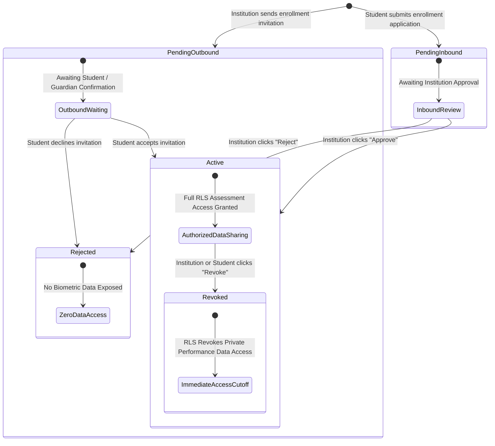

# PratibhaScan Web — Phase 3C Institution Portal Specification

**Company**: KAARYAN LABS  
**Product**: PratibhaScan (*AI-Powered Sports Talent Assessment & Development Platform*)  
**Phase**: Phase 3C — Institution Portal & Secure Student Management  
**Date**: November 2026  
**Status**: Implemented, Verified & Connected to Local Supabase  

---

## 1. Architectural Overview & Value Mapping

Phase 3C upgrades the Institution dashboard from an illustrative preview mockup into a production-grade, secure **Institution Portal**. The portal enables educational institutions (K-12 schools, undergraduate colleges, universities) as well as district and state sports boards and federations to manage student-athlete rosters, process authorization-safe affiliations, monitor physical education test sessions, and view verified sports participation analytics.

All interactions are backed by **Supabase PostgreSQL**, protected by **Row-Level Security (RLS)**, validated with **Zod schemas**, and managed via typed services in [`src/features/institution/institutionService.ts`](file:///c:/Users/kthar/OneDrive/Documents/Web-PratibhaScan/src/features/institution/institutionService.ts).

### Complete Mapping of Institution Portal Values to Database Fields

| Visual Component | Display Label | Data Classification | Database Source / Derivation |
| :--- | :--- | :--- | :--- |
| **Institution Header** | Institution Name | **Real & Connected** | `public.institutions.name` |
| **Institution Type** | Classification Badge | **Real & Connected** | `public.institutions.type` (`'school'`, `'college'`, `'university'`, `'sports_board'`, `'federation'`) |
| **Accreditation State** | "Verified Institution" / "Pending" | **Real & Connected** | `public.institutions.verified` (system-managed) |
| **Location & Contact** | District, State, Email, Phone | **Real & Connected** | `public.institutions.district`, `state`, `contact_email`, `contact_phone` |
| **Affiliated Students** | Total Active Student Roster | **Calculated** | Count of `public.athlete_affiliations` where `institution_id = id` and `status = 'active'` |
| **Pending Requests** | Inbound & Outbound Invites | **Calculated** | Count of `public.athlete_affiliations` where `institution_id = id` and `status = 'pending'` |
| **Staff Evaluators** | Authorized Testers | **Real & Connected** | Count of `public.evaluator_authorizations` where `institution_id = id` and `status = 'active'` |
| **Logged Assessments** | Official School Test Sessions | **Real & Connected** | Count of `public.assessment_sessions` where `institution_id = id` |
| **Sports Breakdown** | Participation Distribution | **Calculated** | Real tally of primary sports among active enrolled students (no fake percentages) |
| **Student Roster** | Student Full Name & UUID | **Real & Connected** | `public.user_profiles.full_name` & `public.athletes.id` |
| **Candidate Sport** | Primary & Secondary Sport | **Real & Connected** | `public.athletes.primary_sport`, `secondary_sport` |
| **Age & Minor Tag** | Chronological Age & Minor Flag | **Calculated** | Dynamic derivation from `public.athletes.date_of_birth` (`< 18`) |
| **30m Acceleration** | Best Sprint Score (s) | **Real & Connected** | Query on `assessment_results` (accessible only for `status = 'active'`) |
| **Vertical Jump** | Best Jump Score (cm) | **Real & Connected** | Query on `assessment_results` (accessible only for `status = 'active'`) |
| **Affiliation Status** | Active / Invited / Pending / Revoked | **Real & Connected** | `public.athlete_affiliations.status` |
| **Action: Inspect** | Student Passport Inspection | **Real & Connected** | Opens [`StudentDetailInspectModal.tsx`](file:///c:/Users/kthar/OneDrive/Documents/Web-PratibhaScan/src/features/institution/StudentDetailInspectModal.tsx) |
| **Action: Approve/Reject**| Inbound Application Actions | **Interactive Mutation**| Calls `approveStudentAffiliation()` or `rejectStudentAffiliation()` |
| **Action: Revoke** | Terminate Student Affiliation | **Interactive Mutation**| Calls `revokeStudentAffiliation()` (terminates RLS access) |

---

## 2. Permitted Profile Editing vs. Protected Fields

Strict security boundaries are maintained between institutional self-service updates and protected system invariants:

### Permitted Profile Update Fields
Managed via [`InstitutionEditModal.tsx`](file:///c:/Users/kthar/OneDrive/Documents/Web-PratibhaScan/src/features/institution/InstitutionEditModal.tsx) and validated by [`institutionSchemas.ts`](file:///c:/Users/kthar/OneDrive/Documents/Web-PratibhaScan/src/features/institution/institutionSchemas.ts):
- **Institution Name**: 3 to 150 characters (`institutions.name`)
- **Institution Classification (`type`)**: Validated against `school`, `college`, `university`, `sports_board`, `federation` (`institutions.type`)
- **Official Contact Email**: Valid email format (`institutions.contact_email`)
- **Contact Phone**: Optional 10–15 digit phone (`institutions.contact_phone`)
- **State & District**: Geopolitical location (`institutions.state`, `institutions.district`)

### Strictly Protected Fields (Immutable by Institution)
1. **Institution Owner (`owner_id`)**: Prevented at database level by trigger `trg_guard_institution_update` (`SQLSTATE P0001: Unauthorized: Institution ownership cannot be transferred without administrative authorization`).
2. **Accreditation Verification (`verified`)**: Only platform administrators or state sports ministry audits can set verified.
3. **Primary Role (`role`)**: Locked to `'institution'` via `trg_guard_user_profile_update`.
4. **Suspension Status (`is_suspended`)**: Cannot be altered by institution accounts.

---

## 3. Student-Athlete Affiliation Lifecycle & Evaluator Gating

To prevent unilateral enrollment claims and guarantee compliance with India's **Digital Personal Data Protection (DPDP) Act 2023**, student affiliations follow a strict dual-key lifecycle:



### Key Security & Authorization Principles:
- **No Automatic Evaluator Privileges**: Institution staff and teachers do **not** automatically become authorized evaluators merely by holding an institution login. Conducting formal test sessions requires accredited entries in `public.evaluator_authorizations` or direct institution ownership verified via `is_authorized_evaluator()`.
- **Self-Evaluation Strictly Prohibited**: The database constraint `check_no_self_evaluation (athlete_id != evaluator_id)` ensures student-athletes can never record scores for themselves.
- **Pending Gating**: The database security function `has_active_institution_affiliation(p_athlete_id, p_institution_owner)` returns `FALSE` while status is `'pending'`. Private test marks and trial scores are completely inaccessible.
- **Immediate Cutoff on Revocation**: Calling `revokeStudentAffiliation()` sets status to `'revoked'`, instantly cutting off RLS access to private student assessment sessions.

---

## 4. Minor Student Safeguards (DPDP Act 2023 Compliance)

In compliance with India's **Digital Personal Data Protection Act 2023** regulations on processing children's personal and biometric data:
1. **Dynamic Minor Detection**: Students with chronological age $< 18$ years are automatically tagged with a statutory `Minor Candidate` badge.
2. **Statutory Notice & Disclaimers**: The dashboard and inspection modals display prominent regulatory disclaimers:
   > *"DPDP Act 2023 Student Safeguard Notice: Enrolling minor students (< 18 years) mandates verifiable parental or legal guardian consent. Affiliation approval authorizes institutional physical education participation but does not substitute for statutory guardian consent."*
3. **No Automatic Data Exposure**: Outbound invitations to minors remain in pending status with zero biometric data sharing until verified guardian acceptance is recorded.

---

## 5. UI Architecture & Components

```
src/features/institution/
├── __tests__/
│   └── institutionData.test.ts          # 16 Unit & schema validation tests
├── InstitutionEditModal.tsx             # Permitted profile updating modal
├── StudentEnrollModal.tsx               # UUID-based candidate enrollment invitation modal
├── StudentDetailInspectModal.tsx        # Comprehensive student passport inspect modal
├── institutionSchemas.ts                # Zod schemas for validation
├── institutionService.ts                # Supabase data retrieval and mutation operations
└── InstitutionView.tsx                  # Main Institution Portal view (Preview + Authenticated)
```

### Preview vs. Authenticated Mode
- **Preview Mode (`/preview/institution`)**: Renders illustrative district scouting and federation demo data (`DISTRICT_DATA`), allowing public demonstration without database authentication.
- **Live Authenticated Mode (`/dashboard/institution`)**: Connects to the authenticated user's registered institution record in Supabase, loading live student cohorts, pending applications, authorized staff evaluators, and conducting real-time mutations with rollback error handling.
