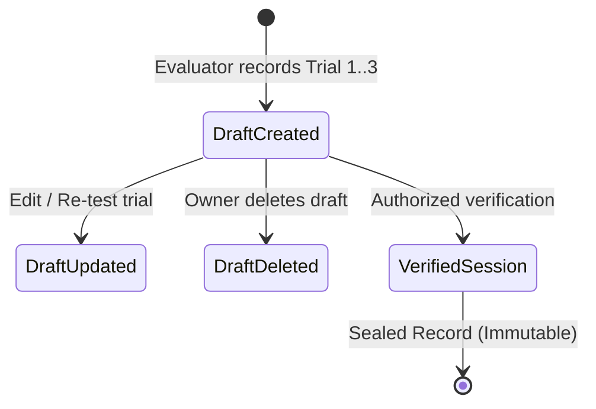

# PRATIBHASCAN WEB — PHASE 3D: SECURE SPORTS ASSESSMENT ENGINE & PERFORMANCE TRACKING

**Company:** KAARYAN LABS  
**Product:** PratibhaScan (*AI-Powered Sports Talent Assessment & Development Platform*)  
**Architecture:** React 19, TypeScript, Vite, Tailwind CSS, Supabase PostgreSQL, Row-Level Security (RLS)  
**Date:** November 13, 2026  
**Status:** IMPLEMENTED & TESTED (Phase 3D Complete)

---

## 1. Executive Overview

Phase 3D delivers a sports assessment management system for PratibhaScan. Built upon our existing PostgreSQL database and premium light-themed design system, Phase 3D transitions physical fitness evaluations from isolated client demos into a multi-trial evaluation battery.

Authorized evaluators (academy coaches and school physical education directors) can now:
1. Select actively affiliated athletes (with strict self-evaluation prevention and minor safeguard alerts).
2. Select standard physical assessment protocols modeled on Sports Authority of India (SAI) guidelines.
3. Record up to 3 individual trial measurements with live numerical validation against physiological boundaries.
4. Automatically compute the official benchmark score adhering to protocol-specific directional rules (lower is better vs. higher is better).
5. Save draft results or permanently verify and seal sessions via cryptographic PostgreSQL triggers.
6. Display authentic biometric history and longitudinal trends within the Athlete Dashboard.

---

## 2. Standardized Assessment Suite Architecture

The assessment battery consists of 6 standardized physical and biometric protocols modeled on national sports talent identification procedures (SAI and Khelo India norms).

### Supported Protocol Battery

| Protocol Code | Test Name | Category | Unit | Directional Rule | Max Attempts | Valid Technical Range |
| :--- | :--- | :--- | :--- | :--- | :--- | :--- |
| `TEST_30M_SPRINT` | 30-Meter Acceleration Sprint | Speed | `sec` | **Lower is Better** (Min) | 3 trials | 3.00s – 12.00s |
| `TEST_VERT_JUMP` | Countermovement Vertical Jump | Power | `cm` | **Higher is Better** (Max) | 3 trials | 10.0cm – 120.0cm |
| `TEST_BEEP_RUN` | 20m Multi-Stage Shuttle Run (Beep Test) | Endurance | `shuttles` | **Higher is Better** (Max) | 1 trial | 1 – 200 shuttles |
| `TEST_SIT_REACH` | Standardized Sit and Reach Test | Flexibility | `cm` | **Higher is Better** (Max) | 3 trials | 0.0cm – 60.0cm |
| `TEST_ILLINOIS` | Illinois Agility Run | Agility | `sec` | **Lower is Better** (Min) | 3 trials | 12.00s – 35.00s |
| `TEST_ANTHRO` | Anthropometric Baseline & Ape Index | Anthropometric | `cm` | Informational Baseline | 1 trial | 100.0cm – 240.0cm |

> **Certification Disclaimer:** Protocols are modeled on established sports science methodologies and SAI guidelines. In strict accordance with platform standards, protocols are not advertised as officially federation-certified without evidence of official institutional audit.

---

## 3. Multi-Trial Calculation & Validation Algorithms

All calculation and validation logic is implemented in pure, deterministic TypeScript within `src/features/assessments/assessmentCalculations.ts`.

### 1. Measurement Range Validation (`validateMeasurement`)
- **Non-Negative Constraint:** Enforces $value \ge 0$, strictly aligning with the database schema `CHECK (trial >= 0)`.
- **Physiological Boundaries:** Rejects impossible inputs (e.g., a 30m sprint under 3.0s or above 12.0s).
- **Graceful Nullability:** Allows empty or partial trial attempts while field assessments are underway.

### 2. Best-Result Computation (`calculateBestScore`)
- **Directional Scoring:**
  - When `lowerIsBetter = true` (Sprint, Agility):
    $$\text{Best Score} = \min(\{t_1, t_2, t_3\} \setminus \{\text{null}\})$$
  - When `lowerIsBetter = false` (Jump, Reach, Beep Test):
    $$\text{Best Score} = \max(\{t_1, t_2, t_3\} \setminus \{\text{null}\})$$
- **Database Precision:** Automatically rounds scores to 2 decimal places to match PostgreSQL `NUMERIC(8, 2)`.

### 3. Normative Age-Group Percentile Estimation (`estimatePercentileRank`)
- Estimates youth national athletic percentiles (ages 12–18) modeled on SAI normative distributions.
- Scores are bounded strictly between the 1st and 99th percentiles.
- Structural tests (e.g. Anthropometric height/wingspan) return `null` as they represent structural traits rather than ranked performance.

---

## 4. Assessment Session Lifecycle & State Machine

1. **Draft Stage (`verified = FALSE`, `status = 'pending'`):**
   - Evaluator initiates testing for an actively affiliated athlete.
   - Trials are recorded, validated, and saved.
   - Drafts can be edited or deleted by the organization owner.
2. **Verification Stage (`verified = TRUE`, `status = 'verified'`):**
   - When verified, the PostgreSQL trigger `guard_assessment_session_update` stamps `verified_by = auth.uid()`.
   - **Immutability Enforcement:** The trigger raises an exception on any subsequent `UPDATE` or `DELETE` attempt from client identities.

---

## 5. UI/UX Implementation Details

1. **Protocol Library (`ProtocolCard.tsx`):**
   - Displays category badges, unit tags, scoring direction pills, allowable ranges, attempt counts, and collapsible methodology details with required equipment checklists.
   - Action buttons let authorized coaches launch a test directly from any protocol card.
2. **Guided Session Creation Wizard (`NewAssessmentModal.tsx`):**
   - **Step 1:** Select from actively affiliated athletes (shows age, sport, and minor safeguards).
   - **Step 2:** Select protocol with dynamic unit and rule display.
   - **Step 3:** Session metadata (date, venue, environmental notes).
   - **Step 4:** Multi-trial entry fields with real-time range validation, live best score computation, and immediate visual feedback.
3. **Session Record Details Modal (`SessionDetailsModal.tsx`):**
   - Displays full session details: athlete name, evaluator, venue, verified status badge, and complete trial breakdown table.
   - Includes actions to verify draft sessions or delete unverified drafts.
4. **Athlete Dashboard Integration (`AthleteView.tsx`):**
   - Key metrics (30m Sprint, Vertical Jump, Beep Test) dynamically populate from verified database records.
   - Historical assessment log details each session, trials, evaluator, and official verification badges.
   - Displays empty states with actionable navigation when no sessions are recorded.

---

## 6. Files Created & Modified

| File | Change | Description |
| :--- | :--- | :--- |
| `supabase/migrations/20261113000000_seed_assessment_protocols.sql` | **Created** | Seeds 6 immutable assessment protocols into PostgreSQL. |
| `src/types/assessment.types.ts` | **Updated** | Added session creation input types and record interfaces. |
| `src/features/assessments/assessmentCalculations.ts` | **Created** | Deterministic multi-trial scoring, range validation, and percentile logic. |
| `src/features/assessments/assessmentService.ts` | **Created** | Supabase database operations for sessions, eligible athletes, and verification. |
| `src/features/assessments/ProtocolCard.tsx` | **Created** | Accessible, responsive protocol card component with methodology drawer. |
| `src/features/assessments/NewAssessmentModal.tsx` | **Created** | Multi-step assessment creation and live multi-trial entry modal. |
| `src/features/assessments/SessionDetailsModal.tsx` | **Created** | Detailed session inspection and verification modal. |
| `src/features/assessments/AssessmentsView.tsx` | **Updated** | Complete assessment suite view with tabs for protocols and live session logs. |
| `src/features/assessments/index.ts` | **Created** | Public exports for assessment features. |
| `src/features/academy/AthleteDetailInspectModal.tsx` | **Updated** | Added quick action link to conduct assessments for active athletes. |
| `src/features/institution/StudentDetailInspectModal.tsx` | **Updated** | Added quick action link to conduct assessments for active students. |
| `src/features/assessments/__tests__/assessmentCalculations.test.ts` | **Created** | 24 unit tests covering validation, best score selection, and percentiles. |
| `src/features/assessments/__tests__/assessmentService.test.ts` | **Created** | 7 service and authorization unit tests. |
