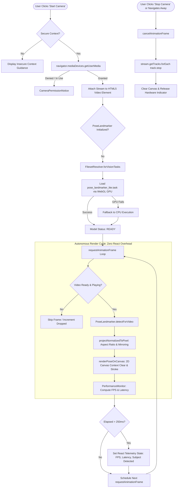

# PRATIBHASCAN WEB — PHASE 4A ARCHITECTURE
## AI Pose Detection Studio & Real-Time Computer Vision Pipeline

**Company:** KAARYAN LABS  
**Product:** PratibhaScan (*AI-Powered Sports Talent Assessment & Development Platform*)  
**Module:** Phase 4A — MediaPipe AI Pose Detection & Live Camera System  
**Document Version:** 1.0  
**Date:** November 14, 2026  
**Authors:** Senior Computer Vision Engineer & React/TypeScript Architect  

---

## 1. Architectural Overview

Phase 4A introduces a browser-native, privacy-preserving computer vision engine into PratibhaScan Web. The subsystem enables on-device human pose landmark estimation at 30+ frames per second using the official Google MediaPipe Tasks Vision runtime (`@mediapipe/tasks-vision` v1.2.3) in `VIDEO` running mode.

### Core Architectural Principles
1. **Zero Cloud Latency & Zero Transmission:** Video frames are captured and processed entirely in browser volatile memory (WebGL / WebAssembly). No raw frames or coordinate streams are transmitted to Supabase, third-party AI APIs, or external storage.
2. **Separation of Concerns:** Hardware stream acquisition (`cameraService`), ML inference pipeline (`poseLandmarkerService`), coordinate projection & rendering (`landmarkTransform`), and UI components are strictly decoupled.
3. **Decoupled Render Loop (Jank-Free 60 FPS):** MediaPipe inference and canvas drawing run inside an autonomous `requestAnimationFrame` loop. Frame rendering bypasses React state updates entirely, while high-level telemetry (FPS, subject detection, latency) is throttled to update React UI once every 250ms.
4. **Resilient Hardware Fallbacks:** WebGL GPU acceleration is attempted first. If hardware acceleration or shader compilation fails, the system automatically falls back to CPU execution without throwing unhandled exceptions to the user.

---

## 2. Component & Module Hierarchy

```
src/features/pose-detection/
├── PoseDetectionView.tsx           # Primary Studio workspace view
├── index.ts                        # Barrel exports for the module
├── types/
│   └── pose.types.ts               # Strict TypeScript definitions, landmarks enum, connections
├── services/
│   ├── cameraService.ts            # MediaDevices getUserMedia, device enumeration & permissions
│   └── poseLandmarkerService.ts    # MediaPipe Tasks Vision singleton, GPU/CPU fallback & inference
├── hooks/
│   ├── useCamera.ts                # Camera stream state, hardware switching & unmount cleanup
│   └── usePoseDetection.ts         # RAF inference loop, canvas sync & throttled telemetry
├── utils/
│   ├── landmarkTransform.ts        # Coordinate transformation, aspect ratio scaling & canvas renderer
│   └── performanceMonitor.ts       # Sliding window FPS & per-frame latency monitor
└── components/
    ├── CameraPreview.tsx           # Video container, hardware canvas overlay & badges
    ├── CameraControls.tsx          # Start/Stop, Switch Camera, Skeleton/Joint toggles, Pause/Resume
    ├── PoseStatusPanel.tsx         # Live telemetry cards (Subject, FPS, Latency, Hardware, AI Model, Device)
    └── CameraPermissionNotice.tsx  # User-friendly guidance for permission or hardware issues
```

---

## 3. Data Flow & Inference Pipeline



---

## 4. Key Engineering Implementations

### 4.1 Monotonic Timestamp Management
MediaPipe Tasks Vision `detectForVideo(videoFrame, timestamp)` strictly mandates that `timestamp` is monotonically increasing (`timestamp > lastTimestamp`). On high-refresh screens (120Hz/144Hz) or background tab wakeups, `performance.now()` can produce identical or retrograding timestamps.
`poseLandmarkerService.detectForVideo` enforces:
```ts
const safeTimestamp = timestamp <= this.lastProcessedTimestamp 
  ? this.lastProcessedTimestamp + 1 
  : timestamp;
```
This eliminates the fatal MediaPipe runtime exception: `Input timestamp must be monotonically increasing`.

### 4.2 Front-Facing Camera Mirroring
When using the front camera (`facingMode: 'user'`), users expect natural mirror behavior (raising the left hand corresponds to the left side of the screen).
1. The `<video>` element is mirrored via CSS: `-scale-x-100`.
2. The `<canvas>` coordinate projection in `projectNormalizedToPixel` flips the x-coordinate:
   ```ts
   if (isMirrored) {
     px = canvasWidth - px;
   }
   ```
This aligns the skeleton overlay with the mirrored video feed down to the exact pixel.

### 4.3 Responsive Viewport Adaptation (Cover vs Contain)
Cameras typically output in 4:3 (e.g. 640x480) or 16:9 (1280x720). Responsive CSS containers may be 16:9 on desktop and 4:3 or 1:1 on mobile screens.
`projectNormalizedToPixel` calculates aspect ratio deltas and scaling offsets (`offsetX`, `offsetY`) to prevent skeleton displacement when CSS applies `object-fit: cover`.

---

## 5. Security & Privacy Safeguards

- **Camera Permission:** The camera is **never** initiated automatically on page load. An explicit user click on `Start Camera` is mandatory.
- **Audio Exclusion:** Media constraints strictly specify `audio: false` to ensure no microphone permissions are requested.
- **Zero Network Ingestion:** Video frames are analyzed locally in browser memory. No base64 strings, canvas exports, or kinematic vectors are transmitted over the network or saved to Supabase.
- **Hardware Teardown:** Both `useCamera` and `stopMediaStream` cleanly iterate through all tracks and invoke `track.stop()`, extinguishing the physical webcam LED indicator immediately upon camera stop or page navigation.
